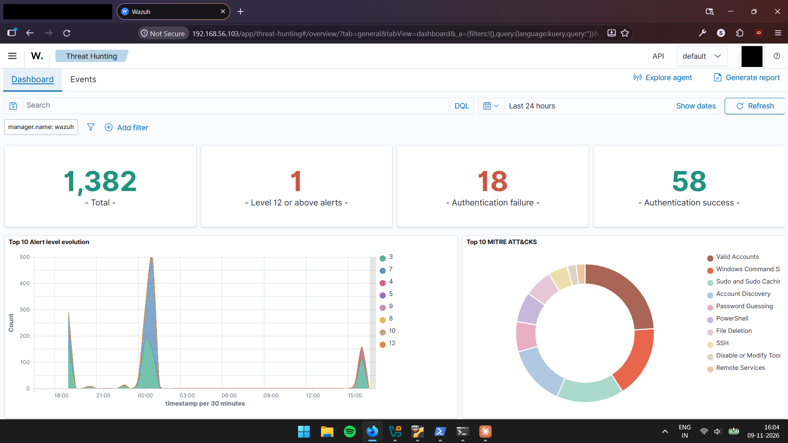
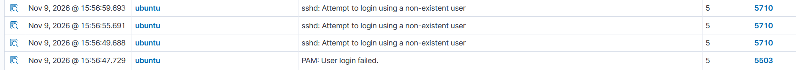

# SOC-Detection-Engineering-Lab

A multi-machine detection engineering homelab built on Oracle VirtualBox. Wazuh collects telemetry from a Linux server endpoint and a Windows 11 host (with Sysmon), and a Kali Linux VM generates controlled adversary activity against those endpoints. The lab is used to observe the path from raw log event to decoded field to matched rule to alert, and to build detection and investigation skills on top of that pipeline.

This is a single-operator lab environment. It is not a production deployment and does not represent an enterprise SOC.

All activity in the lab is generated by the operator on systems they own: every login, failed login attempt, scan and simulation. No third-party or real-world attacker traffic is involved. Where a log line looks like an intrusion, the relevant document states whether it was a planned simulation or the operator's own administrative or exploratory activity.

## Objectives

1. Deploy a working Wazuh all-in-one stack (manager, indexer, dashboard) on an isolated lab network.
2. Enroll heterogeneous endpoints (Linux and Windows) and confirm telemetry reaches the manager.
3. Add endpoint process telemetry on Windows through Sysmon and confirm it is decoded and alerted on.
4. Run controlled, documented attack simulations and trace each one through the detection pipeline.
5. Record MITRE ATT&CK mappings carried by the alerts, and be explicit about what those mappings do and do not prove.
6. Document failures and their resolution alongside the successes.

## Evidence status legend

Every factual claim in this repository is tagged with one of the following:

| Label | Meaning |
|---|---|
| **Verified** | Supported by a screenshot, terminal capture, configuration file or raw alert stored under [`evidence/`](evidence/). |
| **Reported** | Observed by the operator during implementation, but the supporting capture is not yet stored in this repository. |
| **Pending Verification** | Not yet confirmed by any captured evidence. |

## Architecture summary

| Role | Name (agent ID) | Platform | Lab IP (host-only) | Status |
|---|---|---|---|---|
| Wazuh server (all-in-one) | `wazuh` (`000`, local) | Ubuntu Server 24.04.5 LTS VM | `192.168.56.103` | **Verified** |
| Linux endpoint | `ubuntu` (`001`) | Ubuntu Server 24.04.5 LTS VM | `192.168.56.104` | **Verified** |
| Windows endpoint | `windows-host` (`002`) | Windows 11, **physical host machine, not a VM** | `192.168.56.1` | **Verified** |
| Attacker | `kali` (no agent) | Kali Linux VM | `192.168.56.105` | **Verified** |

Each VM has two adapters: VirtualBox NAT (internet access for packages) and Host-only (`192.168.56.0/24`, lab traffic). This is **Verified** for all three VMs by `ip -br addr`, and for the Wazuh VM also by its VirtualBox settings. The Windows host takes part through its VirtualBox Host-Only adapter. Addresses are DHCP-assigned and can change unless static addresses or reservations are configured.

Full details: [docs/architecture.md](docs/architecture.md).

## Technology stack

| Component | Version / detail | Status |
|---|---|---|
| Oracle VirtualBox | Pending Verification | — |
| Wazuh server (manager, indexer, dashboard) | `v4.14.10` (`wazuh-control info`, revision string `rc2`) | **Verified** |
| Wazuh agent (Windows) | 4.14.10, installed from `wazuh-agent-4.14.10-1.msi` | **Verified** (MSI log) |
| Wazuh agent (Ubuntu) | Pending Verification | — |
| Sysmon | v15.22, service `Sysmon64` running, default configuration with no rules (network-connection and image-load logging disabled) | **Verified** (`Sysmon64.exe -c`) |
| OpenSSH on Ubuntu endpoint | `OpenSSH 9.6p1 Ubuntu 3ubuntu13.20` | **Verified** (Nmap) |
| Nmap on Kali | Banner reads `7.991` | **Verified** as captured; see [evidence index](docs/evidence-index.md) |

## Current implementation status

| Capability | Status | Evidence |
|---|---|---|
| Wazuh manager running v4.14.10, listening on 1514/1515/443/55000 | **Verified** | `server-status.txt` |
| Agents `000`, `001`, `002` all Active | **Verified** | `agent_control -l` |
| Dashboard reachable from Windows host | **Verified** | Dashboard screenshots |
| Ubuntu agent `001` collecting `journald` and generating alerts | **Verified** | Raw alert (rule 5710) |
| Windows agent `002` collecting Application, Security, System, Sysmon channels | **Verified** | Agent `ossec.conf`, raw alert (rule 92027) |
| Sysmon Event ID 1 generated locally and alerted on in Wazuh | **Verified** | Local `Get-WinEvent` export, raw alert |
| INC-001: controlled invalid-user SSH authentication test | **Verified** | Kali capture, Ubuntu auth log, Wazuh alerts 5710 / 5503 / 2502 |
| TS-01: manager TCP 1514 listener failure (stale PID files) diagnosed, root-caused and recovered | **Root cause Verified**: an unclean shutdown left stale PID files; at the next boot the start script's PID-only check skipped `wazuh-remoted` *and* `wazuh-syscheckd` for ~23½ min. Only the holder of PID 1245 (`wazuh-db`) is **Reported** | `wazuh-control` + journal, `ossec.log`, `ss -lntp` |
| TS-03: scoped Windows firewall rule allowing ICMP echo from the lab subnet | Result **Verified** (Kali ping 3/3); rule definition **Reported** | `connectivity-checks.txt`; rule export not yet stored |
| Kali reachability of manager ports 443 / 1514 / 1515 | **Verified** | `connectivity-checks.txt` |
| DET-001: custom decoder adds `data.srcip` to rule 2502 (sshd PAM summary) | **Verified** (v1 end to end; v2 file, logtest and regression). The two-failure gap it exposed is handled by DET-003 | [`detections/DET-001.md`](detections/DET-001.md), E-28–E-36 |
| DET-003: custom rule 100100 alerts on SSH sessions with exactly two failed passwords (singular PAM summary, which built-in rules drop at level 0) | **Verified** end to end: gap confirmed live, `wazuh-logtest` with regression, live alert with `data.srcip` | [`detections/DET-003.md`](detections/DET-003.md), E-37–E-40 |
| Custom Wazuh rules | Not started (`etc/rules` user ruleset path is configured) | Manager `ossec.conf` |
| Custom Sysmon configuration | Not started: default config, no rules installed | `Sysmon64.exe -c` |
| Windows attack simulations | Not started | — |
| Active response | **Not configured**: `<active-response>` block commented out on the manager | Manager `ossec.conf` |

## Documentation

| Document | Contents |
|---|---|
| [docs/architecture.md](docs/architecture.md) | Topology, VM resources, ports, end-to-end data flow, security observations, Mermaid diagrams |
| [docs/deployment.md](docs/deployment.md) | Server, agent, Sysmon and Kali configuration; verification procedures |
| [docs/attack-simulations/INC-001-ssh-authentication-failure.md](docs/attack-simulations/INC-001-ssh-authentication-failure.md) | Controlled invalid-user SSH test, timeline, alert and MITRE analysis |
| [docs/troubleshooting.md](docs/troubleshooting.md) | TCP 1514 listener / stale PID recovery and other issues |
| [detections/DET-001.md](detections/DET-001.md) | Custom decoder extracting the source IP for rule 2502, before/after evidence, regression plan, limitations |
| [detections/DET-003.md](detections/DET-003.md) | Custom rule for two-failure SSH sessions: live gap evidence, root cause from the rule source, tests, limitations |
| [docs/roadmap.md](docs/roadmap.md) | Implemented vs planned work |
| [docs/evidence-index.md](docs/evidence-index.md) | Every evidence file, what it proves, and what is still missing |

## Repository layout

```
SOC-Detection-Engineering-Lab/
├── README.md
├── docs/
│   ├── architecture.md
│   ├── deployment.md
│   ├── troubleshooting.md
│   ├── roadmap.md
│   ├── evidence-index.md
│   └── attack-simulations/
│       └── INC-001-ssh-authentication-failure.md
├── detections/
│   ├── DET-001.md
│   ├── DET-003.md
│   └── rules/
│       ├── local_decoder.xml   # deployed to /var/ossec/etc/decoders/
│       └── local_rules.xml     # deployed to /var/ossec/etc/rules/
└── evidence/
    ├── wazuh/      # server status, manager ossec.conf, dashboard screenshots, raw alerts
    ├── windows/    # agent ossec.conf, MSI install excerpt, Sysmon captures
    ├── ubuntu/     # endpoint log captures
    ├── kali/       # attacker terminal captures
    ├── network/    # interface/IP captures
    └── virtualbox/ # VM settings screenshots
```

Folders for `simulations/` and `diagrams/` will be added when they have real content (see [roadmap](docs/roadmap.md)). Diagrams are currently Mermaid blocks inside the docs.

## Selected evidence

Wazuh Threat Hunting dashboard, last 24 hours, showing alerts from all three agents (`windows-host`, `wazuh`, `ubuntu`):



INC-001 alerts on agent `ubuntu`: rule 5710 (non-existent user) and rule 5503 (PAM login failure):



## Time zones used in evidence

Evidence comes from machines with different clocks. All timelines in these docs are normalised to UTC.

| Source | Displayed zone | Basis |
|---|---|---|
| Wazuh raw alert JSON, Ubuntu `auth.log` | UTC | `+0000` / `+00:00` suffixes |
| Wazuh dashboard, Windows host (PowerShell, MSI log) | UTC+05:30 | Dashboard `15:56:59.693` = JSON `10:26:59.693Z`; Sysmon `TimeCreated 17:11:32` = `UtcTime 11:41:32` |
| Kali terminal | UTC−05:00 | Nmap banner `05:26 -0500` |
