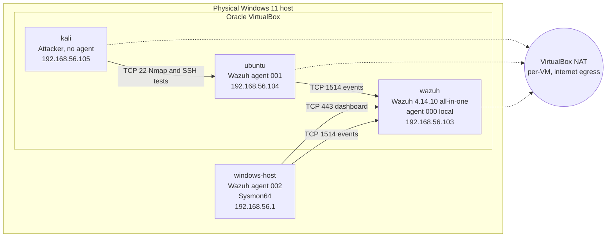
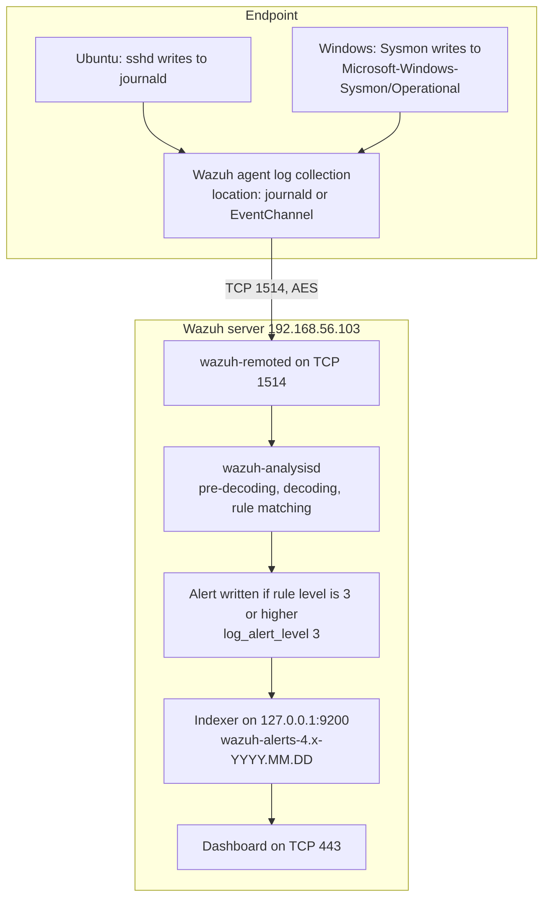

# Architecture

Status labels (**Verified**, **Reported**, **Pending Verification**) are defined in the [README](../README.md#evidence-status-legend).

## 1. System overview

The lab has four participants on one VirtualBox host-only network:

- **Wazuh server**: a single Ubuntu Server VM running the Wazuh all-in-one deployment (manager, indexer, dashboard, API). It receives agent traffic, decodes and evaluates events, stores alerts, and serves the dashboard. It also monitors itself as agent `000`.
- **Ubuntu endpoint**: an Ubuntu Server VM with the Wazuh agent (`001`). It is the target for Linux-side simulations (INC-001).
- **Windows endpoint**: the **physical Windows 11 machine** that hosts VirtualBox, running the Wazuh agent (`002`) and Sysmon. It is not a VM and is not isolated from the operator's daily use, which matters for how its telemetry is interpreted (see §7).
- **Kali Linux**: an attacker VM used only to generate controlled test activity. It has no Wazuh agent.

## 2. Topology

Solid lines are host-only (`192.168.56.0/24`) traffic. Dotted lines are NAT adapters used for package installation and updates.

### Network configuration

| Machine | Adapter 1 (NAT) | Adapter 2 (Host-only) | Status |
|---|---|---|---|
| Wazuh server | `enp0s3` `10.0.2.15/24` | `enp0s8` `192.168.56.103/24` | **Verified** (`ip -br addr`; VirtualBox settings: Adapter 1 NAT, Adapter 2 Host-only "VirtualBox Host-Only Ethernet Adapter") |
| Ubuntu endpoint | `enp0s3` `10.0.2.15/24` | `enp0s8` `192.168.56.104/24` | **Verified** (`ip -br addr`) |
| Kali | `eth0` `10.0.2.15/24` | `eth1` `192.168.56.105/24` | **Verified** (`ip -br addr`) |
| Windows host | n/a (physical NICs) | "Ethernet 2" (VirtualBox Host-Only Ethernet Adapter) `192.168.56.1/255.255.255.0`, no default gateway | **Verified** (`Get-NetIPConfiguration`, `ipconfig`) |

**Why two adapters.** NAT gives each VM outbound internet access for packages without exposing it on the physical LAN. Host-only gives a private segment where VMs and the host can reach each other directly. Keeping lab traffic on host-only also keeps attack simulations off the physical LAN.

**NAT mode detail.** All three VMs hold `10.0.2.15` on their NAT adapters. That is the expected behaviour of VirtualBox's classic per-VM **NAT** mode, where each VM gets its own private NAT network, as opposed to a shared *NAT Network*. VMs therefore cannot reach each other over adapter 1. All lab traffic has to use the host-only network.

**Interface cross-check.** The Ubuntu host-only interface's link-local address `fe80::a00:27ff:fe91:ca9` decodes (EUI-64) to MAC `08:00:27:91:0c:a9`, which is the MAC Nmap reported from Kali for `192.168.56.104`. This confirms the scanned host is the Ubuntu endpoint VM.

**Windows host firewall.** Inbound ICMP echo to `192.168.56.1` is allowed only from `192.168.56.0/24` by a dedicated rule. Kali receives 3/3 replies (**Verified**). See [TS-03](troubleshooting.md#ts-03-host-only-networking-and-icmp-to-the-windows-host)).

**Addressing caveat.** Host-only addresses come from the VirtualBox host-only DHCP server (the `metric 100` on Ubuntu's `enp0s8` is consistent with a DHCP-learned address). Agents are registered with `IP: any` (`agent_control -l`), so a change of *endpoint* address does not break agent registration. The **manager** address, however, is hard-coded in agent configuration (`<address>192.168.56.103</address>` on Windows). If the Wazuh VM's lease changes, every agent loses its manager. A static address for the Wazuh server is the priority fix (see [roadmap](roadmap.md)).

## 3. VM resource allocation

| VM | RAM | vCPU | Status |
|---|---|---|---|
| Wazuh server | 8192 MB | 4 | **Verified** (VirtualBox details; disk `wazuh.vdi` 80 GB) |
| Ubuntu endpoint | 2 GB | 1 | **Reported** |
| Kali Linux | 3072 MB | 2 | **Verified** (VirtualBox details; disk `kali-linux-2025.4-virtualbox-amd64.vdi` 80 GB) |
| Windows 11 | n/a (physical host) | n/a | — |

The Wazuh server gets the largest share because the indexer (a Java process, PID 864 in `ss` output) is memory-heavy, and the all-in-one layout puts indexer, manager, API and dashboard on the same VM. The Wazuh VM uses an 80 GB `wazuh.vdi` disk on a SATA controller, with Nested Paging and KVM paravirtualization ([VirtualBox details](../evidence/virtualbox/wazuh-vm-details.png)). Disk sizes for the other VMs are not recorded.

## 4. Ports and protocols

Listener state on the Wazuh server is **Verified** from `sudo ss -lntp` ([`server-status.txt`](../evidence/wazuh/server-status.txt)).

| Port | Bind address | Process | Purpose | Notes |
|---|---|---|---|---|
| 1514/tcp | `0.0.0.0` | `wazuh-remoted` | Agent event channel | `<remote>`: `connection secure`, `protocol tcp`, `queue_size 131072` |
| 1515/tcp | `0.0.0.0` | `wazuh-authd` | Agent enrollment | `use_password no`, see §6 |
| 443/tcp | `0.0.0.0` | `node` | Wazuh dashboard | TLS is the all-in-one default; the `https://` scheme is not visible in captures |
| 55000/tcp | `0.0.0.0`, `[::]` | `python3` | Wazuh server API | Used by the dashboard |
| 9200/tcp | `127.0.0.1` only | `java` | Wazuh indexer REST API | Not reachable from the lab network. Manager connects via `https://127.0.0.1:9200` |
| 9300/tcp | `127.0.0.1` only | `java` | Indexer transport | Single node, loopback only |
| 22/tcp | `0.0.0.0`, `[::]` | `sshd` | Admin SSH to the Wazuh server | |
| 1516/tcp | — | — | Wazuh cluster | Not listening: `<cluster><disabled>yes` |

On the Ubuntu endpoint, `22/tcp` is open and serves `OpenSSH 9.6p1 Ubuntu 3ubuntu13.20` (**Verified**, Nmap from Kali).

## 5. Data flow: endpoint event to dashboard alert

The two raw alerts in [`evidence/wazuh/`](../evidence/wazuh/) show each stage:

| Stage | Ubuntu, rule 5710 ([raw](../evidence/wazuh/inc-001-alert-5710-raw.json)) | Windows, rule 92027 ([raw](../evidence/wazuh/sysmon-eid1-alert-92027-raw.json)) |
|---|---|---|
| Collection point (`location`) | `journald` | `EventChannel` |
| Pre-decoding (`predecoder`) | `hostname: ubuntu`, `program_name: sshd`, `timestamp: Nov 09 10:26:59` | n/a (structured event) |
| Decoder (`decoder`) | `sshd` (parent `sshd`) | `windows_eventchannel` |
| Extracted fields | `data.srcip: 192.168.56.105`, `data.srcuser: invaliduser` | `data.win.system.channel`, `eventID: 1`, `image`, `commandLine`, `hashes`, `parentImage` |
| Rule | `5710`, level 5 | `92027`, level 4 |
| Rule groups | `syslog, sshd, authentication_failed, invalid_login` | `sysmon, sysmon_eid1_detections, windows` |
| MITRE on rule | T1110.001, T1021.004 | T1059.001 |
| Index | `wazuh-alerts-4.x-2026.11.09` | `wazuh-alerts-4.x-2026.11.08` |
| Log time → alert time | `10:26:59.476` (auth.log) → `10:26:59.693` | `19:39:42.846` (Sysmon UtcTime) → `19:39:44.332` |

Notes:

- The Ubuntu agent reads from **journald**, not `/var/log/auth.log`. The `auth.log` capture in INC-001 was used to corroborate events independently on the endpoint. The two sources record the same sshd PID (`2296`) and messages. The Ubuntu agent's own `ossec.conf` has not been captured yet (**Pending Verification**).
- `crypto_method aes` is set on the Windows agent and `connection secure` on the manager. Agent traffic is encrypted with per-agent keys.
- The manager sets `log_alert_level 3`, so events matching rules below level 3 do not produce alerts. With `logall no` / `logall_json no`, events that produce no alert are **not archived** at all (see §6).
- Component names `wazuh-remoted`, `wazuh-authd` and the indexer endpoint are **Verified** from `ss` and `ossec.conf`. `wazuh-analysisd` follows the standard Wazuh 4.x architecture. How alerts are shipped to the indexer has not been separately captured.

## 6. Security observations

These come from the captured manager configuration and listener state. They are acceptable trade-offs for an isolated lab, and are recorded so they are deliberate rather than accidental.

| Observation | Evidence | Impact | Lab disposition |
|---|---|---|---|
| Enrollment requires no password (`<use_password>no</use_password>`), and the Windows MSI log shows `SetRegistrationPassword` skipped | Manager `ossec.conf`, MSI log | Any host that can reach `192.168.56.103:1515` could register an agent. Kali **can** reach 1515 (**Verified**, `nc -zv`) | Accepted for now. Enabling password enrollment is on the [roadmap](roadmap.md) |
| Attacker VM can reach the dashboard (443) and agent port (1514) | `nc -zv` from Kali (**Verified**) | The SIEM itself is in the attacker's reach on the flat lab network | Expected in a single-subnet lab. Segmentation is out of scope for now |
| `wazuh-authd`, `wazuh-remoted`, API and dashboard bind to `0.0.0.0` | `ss -lntp` | Reachable on every interface, including the NAT adapter | VirtualBox NAT blocks unsolicited inbound traffic unless port-forwarding rules exist. Absence of forwarding rules is **Pending Verification** |
| Indexer bound to loopback only | `ss -lntp` | Indexer API not exposed to the lab network | Good default, keep |
| `logall` / `logall_json` disabled | Manager `ossec.conf` | Raw events that match no rule (or only rules below level 3) are not retained, which limits retrospective hunting | Revisit when doing threat-hunting exercises |
| `<active-response>` block commented out | Manager `ossec.conf` | No automated response. Attacks are detected, never blocked | Intentional at this stage |
| Email notification disabled | Manager `ossec.conf` | Alerts only visible in the dashboard | Acceptable for a lab |

## 7. Design notes and known limitations

| Decision / limitation | Rationale / impact |
|---|---|
| All-in-one Wazuh deployment | Lowest resource footprint and simplest operation for a single-operator lab. Single point of failure, with no indexer redundancy (cluster disabled). |
| Physical Windows host as the Windows endpoint | Avoids running a Windows VM alongside three Linux VMs. Its telemetry mixes test activity with the operator's normal use (e.g. the local Sysmon export is dominated by `git.exe` and `conhost.exe`), so alerts from `windows-host` must be read with that baseline in mind. Destructive Windows simulations should **not** be run on this host (see [roadmap](roadmap.md)). |
| Kali has no agent | It is the adversary in the scenarios. Detections are expected on the targets. |
| Manager self-monitoring (agent `000`) | Collects the server's own `journald`, `/var/log/dpkg.log`, `active-responses.log`, plus periodic `df -P`, `netstat` and `last -n 20` command output. This is why `wazuh` appears as an alert source in the dashboard. |
| DHCP addressing | See §2. The manager address is the critical one. |
| Default Sysmon configuration | v15.22 with no rules installed: every process creation (EID 1) is logged unfiltered, while network connections (EID 3) and image loads (EID 7) are disabled. Process-level visibility is good. Network and module-load visibility on Windows is absent. |
